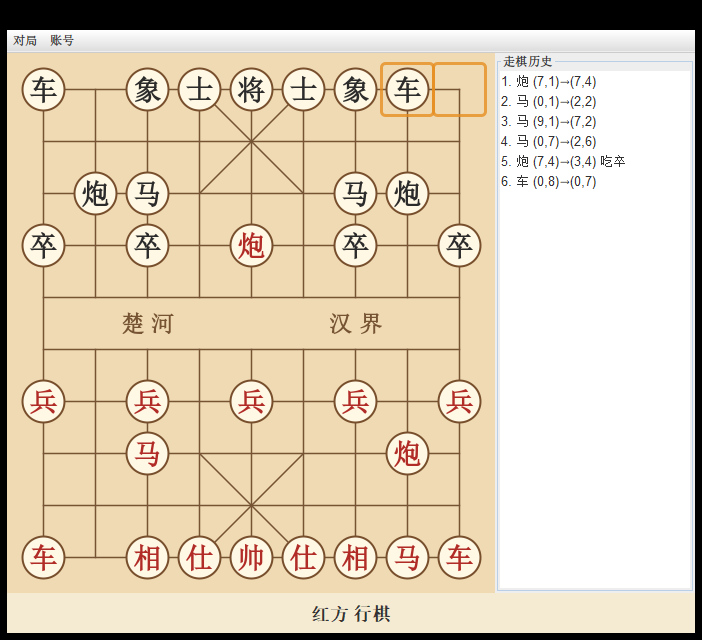

# 中国象棋（Xiangqi）

CS109 课程项目：一个用 **纯 Java（Swing）** 实现的中国象棋，支持多用户登录、存档/读档、完整走子规则与图形界面。
代码追求“简单直接”，不引入任何第三方库，仅用 JDK 标准库。



## 环境要求

- JDK 25 及以上（开发验证于 JDK 26）
- Maven（可选，用于打包；也可直接用 `javac` 编译）

## 启动方式

### 方式一：双击 exe 启动（推荐，无需安装 Java）

直接双击 `XiangQi\dist\XiangQi\XiangQi.exe`（仓库根目录的 `中国象棋.lnk` 快捷方式等价）。
它是用 JDK 自带 `jpackage` 生成的应用镜像，**自带精简 JRE**，目标机器不需要装 Java。

若 `XiangQi\dist` 不存在（例如刚 clone 仓库，构建产物不进版本库），在仓库根目录执行一次：

```powershell
powershell -ExecutionPolicy Bypass -File build-launcher.ps1
```

脚本会自动找 JDK → 编译 → 打 jar → 生成 `XiangQi\dist\XiangQi\XiangQi.exe` 与图标。

### 方式二：直接用 javac / java（无需 Maven）

```bat
cd XiangQi
javac -encoding UTF-8 -d target\classes (src 下所有 .java 文件)
java -cp target\classes edu.sustech.xiangqi.Main
```

### 方式三：Maven

```bat
cd XiangQi
mvn -q package
java -jar target\xiangqi-1.0.jar
```

## 玩法

1. 启动后弹出登录框：可 **登录 / 注册 / 游客进入**。
   - 游客可直接对局，但不能存档/读档。
   - 用户名不可重复注册；账号保存在本地，重启后仍可登录。
2. 菜单栏「对局」选择对局类型：
   - **新游戏（人人对战）**：两人共用一台电脑轮流走子。
   - **新游戏（人机 · 我执红）/（人机 · 我执黑）**：与内置电脑对手对局，电脑走子时状态栏显示“电脑思考中…”。
3. 用鼠标点击己方棋子选中（青色圆圈），再点击目标交叉点落子。
4. 菜单栏「对局」其余项：悔棋、保存游戏…、读取存档…、认输、和棋（双方同意）、退出。
   - 悔棋按整步回退（人机模式下会连电脑的一步一起回退，直到又轮到你走）。
5. 菜单栏「账号」：切换用户、注销。
6. 状态栏显示当前行棋方；被将军时提示“将军”；对局结束显示结果。
   棋盘上用橙色框高亮“上一步”的起点与终点。
7. 右侧「走棋历史」列表实时显示每一步（棋子名、起点、终点、是否吃子）。

## 已实现的需求对照

| 任务 | 说明 | 状态 |
| --- | --- | --- |
| 1 游戏初始化 | 摆满 32 子、红先、可随时开新局 | ✅ |
| 2 多用户登录 | 注册/登录/游客，重名拦截，账号本地持久化 | ✅ |
| 3 存档/读档 | 每用户独立存档（3 个存档位），含局面+回合+走棋历史，可覆盖，防篡改不崩溃，仅能读自己存档 | ✅ |
| 4 对局逻辑 | 七类棋子走法、吃子、回合、将军/将死/困毙、认输、和棋 | ✅ |
| 5 图形界面 | 全 Swing 图形化，无需命令行交互 | ✅ |
| 6 高级功能 | 上一步高亮、走棋历史侧栏、悔棋、人机对战、密码加盐哈希、状态提示、菜单操作 | ✅ |

## 规则实现要点

- 车：直线、路径无子。
- 马：走“日”字，蹩马腿则不能走。
- 炮：直线移动无子；吃子必须且只能隔一个“炮架”。
- 士：九宫内斜走一步。
- 象：走“田”字，不过河，塞象眼不能走。
- 将/帅：九宫内直走一步；不得与对方将帅“照面”。
- 兵/卒：未过河只能前进一步；过河后可前进或左右一步，不可后退。
- 任何走法都必须保证走完后自己不被将军。
- 无合法走法：被将军为“将死”，否则为“困毙”，该方判负。

## 数据存储位置

- 账号：`~/.xiangqi/users.txt`（每行 `用户名<TAB>盐:密码SHA-256`，密码加盐哈希保存；旧明文账号首次登录会自动升级为哈希）
- 存档：`~/.xiangqi/saves/<用户名>/slot1.txt`、`slot2.txt`、`slot3.txt`（三个存档位，带校验，损坏/篡改会被拒绝读取）

## 目录结构

```
XiangQi/
  pom.xml
  launcher/app.ico            启动器图标
  src/main/java/edu/sustech/xiangqi/
    Main.java                 程序入口
    model/                    棋盘、棋子、走法规则、对局状态
      Side / Piece / General / Advisor / Elephant
      Horse / Rook / Cannon / Soldier / Move / Board
      SimpleAi                电脑对手（2 层搜索，无第三方库）
    storage/                  用户与存档
      UserSession / UserStore / SaveStore
    view/                     Swing 界面
      BoardPanel / LoginDialog / ChessFrame
    controller/
      ChessController.java    鼠标交互
  dist/XiangQi/XiangQi.exe    构建产物：双击启动（自带 JRE，不入版本库）
build-launcher.ps1            一键生成上述 exe
需求与Demo现状整理.md          需求清单、原 demo 差距分析（第一阶段产出）
功能完成情况.md                需求 → 实现的完成情况对照（六大任务逐条、未做清单）
代码导览.md                    代码结构、逐类讲解、设计决策与命名理由
```

## 文档

- [`需求与Demo现状整理.md`](需求与Demo现状整理.md)：项目原始需求整理，以及最初那份 demo 骨架与需求之间的差距。
- [`功能完成情况.md`](功能完成情况.md)：**照着需求文档逐条对照“现在做到哪一步、在哪个类/方法里”**，含六大任务打分细项、超出需求的工程化改造、以及仍未实现的加分项清单。
- [`代码导览.md`](代码导览.md)：讲清“代码为什么这样写”——一次点击的完整调用链、四层架构与依赖方向、逐类讲解、文本存档格式、20 条设计决策、命名理由、规则↔代码逐条对照、构建链与改造练习。

## 说明

- 存档格式为纯文本（`XQSAVE1` 头 + 回合 + 棋盘 + 走棋历史），读取时会校验棋子数量与将军合法性，异常一律当作“无存档/无损坏”，不会崩溃。
- 和棋采用“双方同意”按钮直接判定（简化实现）。
- 启动器用 JDK 自带的 `jpackage --type app-image` 生成：一个文件夹（`XiangQi.exe` + `app/` + `runtime/`），整体可拷贝到任何 Windows 机器双击运行；如需单文件安装包，可用 `jpackage --type exe`（需要本机装 WiX）。
